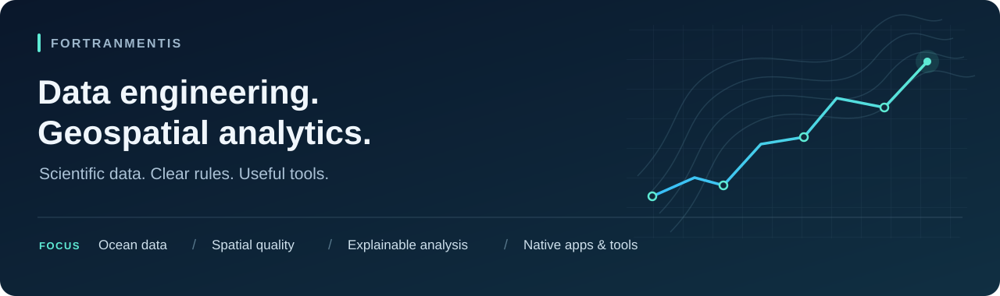
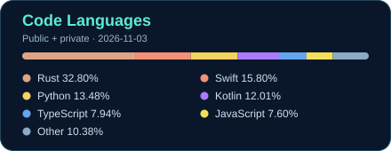

  

  
  
  
  

  <strong>Explore my apps · 앱 소개</strong> 
  <a href="https://fortranmentis.github.io/GPUTERM/">GPUTERM · English</a> · <a href="https://fortranmentis.github.io/GPUTERM/ko/">한국어</a> 
  Korea Toilet Map · 한국 화장실 지도: <a href="https://fortranmentis.github.io/Korea-Toilet-Map/" lang="ko">한국어</a> · <a href="https://fortranmentis.github.io/Korea-Toilet-Map/en/" lang="en">English</a> · <a href="https://fortranmentis.github.io/Korea-Toilet-Map/ja/" lang="ja">日本語</a> · <a href="https://fortranmentis.github.io/Korea-Toilet-Map/zh-hans/" lang="zh-Hans">简体中文</a> · <a href="https://fortranmentis.github.io/Korea-Toilet-Map/zh-hant/" lang="zh-Hant">繁體中文</a> · <a href="https://fortranmentis.github.io/Korea-Toilet-Map/ar/" lang="ar">العربية</a>

  <strong>From scientific datasets to interpretable analysis and practical tools.</strong>

  <a href="#user-content-english">English</a> ·
  <a href="#user-content-한국어">한국어</a> ·
  <a href="#user-content-selected-projects">Projects</a> ·
  <a href="#user-content-research-materials">Research</a> ·
  <a href="#user-content-private-work">Private work</a> ·
  <a href="#user-content-in-action">Demos</a> ·
  <a href="#user-content-toolbox">Tech Stack</a> ·
  <a href="#user-content-github-stats">Stats</a>

---

## Hi, I'm fortranmentis 👋

I am a **Data Engineer at GeoSR**, working with **marine and meteorological data**, scientific pipelines, forecast analytics, fisheries statistics and geospatial workflows.

**Credentials:** Engineer Meteorology (기상기사) · Engineer Ocean Environment (해양환경기사) · Weather Forecaster License (기상예보사).

I build data workflows, spatial applications, and developer tools, with a focus on **climate variability, ocean and atmospheric datasets, and geospatial analysis**. My work spans climate-data statistics, scientific file processing, analytical reporting, tool-calling AI agents, indexed location search, native mobile interfaces for data and server workflows, sensor–forecast integration, and dispatch-simulation prototypes.

**Repository update · November 12, 2026:** added V-PASS Spatial Analytics and the Pocket Weather Station product website, and refreshed aggregate public/private language statistics. Implementation descriptions do not imply that every feature has shipped to app stores.

I care about the details that make data useful: coordinate systems, temporal coverage, missing values, explicit acceptance rules, and a clear distinction between what a result shows and what still needs validation.

| Focus | What I build |
| :--- | :--- |
| **Climate research** | Snow–ocean–atmosphere relationships, regression/composites, EOF analysis, and time-series methods |
| **Data engineering** | Specification checks, NetCDF/CSV processing, raster conversion, and database/service integration |
| **Geospatial analytics** | Numerical-model grid matching, AIS/V-PASS observations, regional/grid statistics, density mapping and spatial joins |
| **Forecast diagnostics** | Paired-product comparisons, model/warning difference summaries, and event-day reporting |
| **AI agents** | Typed tool calling, public-data integration, rule-based itinerary drafts, and inspectable source evidence |
| **Mobile weather sensing** | Barometer observations, altitude correction, forecast fusion, and recorded prediction verification |
| **Spatial applications** | Indexed local datasets, location/heading-aware search, opening-hours logic, and native iOS/Android experiences |
| **Operational simulation** | Deterministic dispatch scenarios, stage-level schedules, and turnaround summaries with documented resource constraints |
| **Developer tooling** | SSH/SFTP workflows, GPU/server telemetry, and LLM runtime monitoring |

## 🧰 Tech Stack

Technologies used across my public and private projects · 공개·비공개 프로젝트에서 사용하는 기술

**Data & Scientific Computing** · 과학 데이터 처리

  
  
  
  
  
  
  

**Geospatial & Visualization** · 공간정보·시각화

  
  
  
  
  
  
  

**AI Agents & APIs** · AI 에이전트·API

  
  

**Agent Orchestration & Observability** · 에이전트 실행·관측

  
  
  
  

**Database** · 데이터베이스

  
  
  

**Native & Systems** · 네이티브·시스템

  
  
  
  

**UI & Applications** · UI·애플리케이션

  
  
  
  

**Also used** · 함께 사용하는 기술

  
  
  
  
  
  
  
  
  
  
  
  

---

## Selected projects

### 🌊 [Ocean Forecast GeoPipeline](https://github.com/fortranmentis/ocean-forecast-geopipeline)

**Connect recurring ocean and sea-ice products to geospatial services.**

Validates incoming NetCDF/CSV files against supplied specifications, regrids and reprojects raster products, derives current speed/direction from U/V components, updates PostgreSQL, and publishes selected GeoServer layers. Field-level reports retain the basis for acceptance decisions.

  
  
  
  
  

### 🚢 [Busan AIS Ship Behavior Analysis](https://github.com/fortranmentis/Busan-AIS-ship-behavior-analysis)

**Make vessel movement patterns inspectable through rules and spatial context.**

Combines AIS trajectories, vessel metadata, and fairway/anchorage polygons to visualize stationary states, fairway exits, and candidate activities. Spatial preprocessing and parallel rendering produce satellite-map time-lapse videos. **Activity labels are heuristic candidates** that require independent confirmation. The [2024 conference poster and January 14, 2025 workshop presentation](https://github.com/fortranmentis/Busan-AIS-ship-behavior-analysis#research-presentations) add methods and map examples; presentation settings are documented separately from the public implementation.

  
  
  
  
  

### 🐟 [V-PASS Spatial Analytics](https://github.com/fortranmentis/vpass-spatial-analytic)

**Turn vessel observations into traceable fisheries-related spatial statistics.**

Batch and spatial workflows for **2023–2025 V-PASS records**: streaming annual merges, explicit speed/vessel-ID selection, monthly and seasonal counts, regional clipping, and observation-count aggregation to existing grids. Weighted Quartic KDE, Jenks classification, **QGIS common-break styling**, and catch-grade joins connect tabular processing to maps while retaining rejection audits, assignment reports and count reconciliation.

**Observation counts, unique vessels and KDE intensity are different measures.** These outputs do not independently establish fishing effort or catch productivity. The repository contains code and documentation; full reproduction requires locally supplied data, reference layers and the QGIS runtime. [Methods](https://github.com/fortranmentis/vpass-spatial-analytic/blob/main/docs/METHODOLOGY.md) · [Validation scope](https://github.com/fortranmentis/vpass-spatial-analytic/blob/main/docs/VALIDATION.md).

  
  
  

### 🌏 [Climate Variability Analysis](https://github.com/fortranmentis/climate-variability-analysis_Jeonbuk-National-University)

**Explore statistical relationships across snow, ocean, and atmosphere.**

A research and coursework archive associated with Jeonbuk National University, examining Jeonju snowfall/snow depth alongside sea surface temperature, atmospheric circulation, and sea ice. Fortran programs, GrADS scripts, and MATLAB routines cover regression, composites, EOF analysis, filtering, and spectral methods.

The **2021 coauthored undergraduate thesis** connects 1983–2021 Jeonju snow observations with NOAA reanalysis through seasonal means, lagged regression and LBM response comparisons. The thesis reports an ENSO association for maximum snow depth and a weaker relation for snow days. [Original thesis, presentation and figures](https://github.com/fortranmentis/climate-variability-analysis_Jeonbuk-National-University#thesis) are linked beside the code.

The [validation record](https://github.com/fortranmentis/climate-variability-analysis_Jeonbuk-National-University/blob/main/VALIDATION.md) documents a limited regression execution check. Full scientific replication, GrADS figure regeneration, and MATLAB execution remain unverified.

  
  
  

### 📍 [Multi-Model Grid Validator](https://github.com/fortranmentis/multi-model-grid-validator)

**Match service locations to nearby model cells that meet explicit value rules.**

Handles **15 model configurations** across ocean, wave, and atmospheric datasets. Selects the nearest eligible cell within **40 km**; non-WRF entries screen the first **up to 20 timesteps**, while WRF entries use coordinate-based matching. Parallel processing combines results into a location-level CSV.

  
  
  
  

### 📊 [Marine Forecast Index Stats](https://github.com/fortranmentis/marine-forecast-index-stats)

**Make changes between marine forecast products easier to inspect.**

Python/pandas scripts compare paired service and prediction spreadsheets, summarize forecast-index changes, and examine differences in model variables and weather warnings. The collection includes event-day and overlap summaries, regional/route/vessel reporting, and Excel/CSV/HTML export code. These comparisons describe changes between products; they do not measure forecast accuracy against observations.

[Validation record](https://github.com/fortranmentis/marine-forecast-index-stats/blob/master/VALIDATION.md): legacy runtime compatibility and output reconciliation remain unresolved.

  
  
  

### 🧭 [Marine Travel AI Agent · 바다결](https://github.com/fortranmentis/marine-travel-AI-agent)

**Turn public coastal data into a travel draft whose inputs and decisions can be inspected.**

**GeoSR · Internal technology development.** A **v0.9 local prototype** for one- to three-day car or walking itineraries across **29 forecast-linked scopes**. Eight typed Ollama tools connect tourism, marine forecasts, weather and transport evidence to a deterministic Python planning engine. Form requests now run through **LangGraph: build → validate → traveler choice → recheck → finish**, with at most two rechecks and fixed-booking preservation. SQLite checkpoints and revisioned plans support reload/restart recovery within retention limits; **n8n** schedules data collection, while **Cytoscape and Langfuse** expose filtered execution events. Route maps, source timestamps, visit edits/undo and PDF exports keep drafts reviewable.

Itineraries remain provisional. Conditional island plans require separate round-trip access checks; operator availability, reservations, age limits, warning bulletins, and on-site access are not established by the draft. The [validation record](https://github.com/fortranmentis/marine-travel-AI-agent/blob/main/VALIDATION.md) distinguishes offline tests from live-provider observations.

  
  
  

  
  
  
  
  
  

### 🖥️ [GPUTERM](https://github.com/fortranmentis/GPUTERM)

**Bring remote server work into one desktop workspace.**

Combines split SSH/local terminals, SFTP transfers, and live system/GPU telemetry. Includes monitoring adapters for Ollama, vLLM, and other LLM runtimes, resource history and alerts, reusable SSH keys, and container/Kubernetes and PostgreSQL/MySQL monitoring where supported by the remote environment. Remote web-service discovery opens TensorBoard, Jupyter, MLflow, Ray, Streamlit, Gradio and code-server through temporary loopback SSH forwarding. Read-only MCP discovery omits login tokens and credential-bearing MLflow URIs. Built with Rust, Tauri and React; desktop releases remain beta.

[Explore the product website →](https://fortranmentis.github.io/GPUTERM/) · [한국어 →](https://fortranmentis.github.io/GPUTERM/ko/) — desktop, native iPhone/iPad and Android features, external-display workspaces, and iOS Siri/Shortcuts integration.

  
  
  
  

### 🚚 [Truck Dispatch Simulator](https://github.com/fortranmentis/truck-dispatch-simulator)

**Explore how dispatch order and intervals change truck turnaround.**

A Python/Tkinter prototype models empty-bottle and empty trucks through inspection, unloading, loading, and outbound stages. Scenario inputs produce stage-level timestamps, loading groups, and per-truck / truck-type mean turnaround times. Original requirements, source iterations, and Excel references keep the assumptions traceable.

The current scheduler has reproducible resource conflicts, including capacity violations in its supplied example. Outputs are **prototype calculations, not validated operational schedules**; see the [diagnostic evidence](https://github.com/fortranmentis/truck-dispatch-simulator/blob/main/docs/VALIDATION.md).

  

[Download GPUTERM](https://github.com/fortranmentis/GPUTERM/releases) · [Browse all repositories](https://github.com/fortranmentis?tab=repositories)

## Selected private work

Alongside the public projects, I develop the following tools in private repositories. These summaries describe their scope; source code and datasets remain private.

### 📱 GPUTERM for iOS & Android

**Extend remote compute workflows to native mobile workspaces.**

Native SSH/SFTP clients with system/GPU telemetry and LLM runtime monitoring. The iOS app connects **SwiftUI to Rust through UniFFI**; the Android app connects **Kotlin/Jetpack Compose to Rust through JNI**. The native implementations include split terminals, SFTP queues, history and alerts, reusable SSH keys, and container/database monitoring. iOS uses SwiftTerm and Keychain; Android uses native terminal rendering and Keystore-backed credential handling with adaptive phone/tablet/desktop layouts. Recent native workflows add **remote web-service discovery on Linux/macOS/Windows**, temporary SSH forwarding, device-authenticated app/credential locks, and opt-in configuration sync. iOS offers iPad/external-display workspaces and **Siri/App Shortcuts**; Android supports adaptive/external-display sessions and folder-based sync. Passwords and private keys remain device-local. Android publication remains release preparation; no Google Play availability is claimed.

  
  
  
  

[Mobile features & external-display workspaces →](https://fortranmentis.github.io/GPUTERM/#mobile) · [Download GPUTERM for iOS on the App Store →](https://apps.apple.com/app/gputerm/id6824499888)

### 🗺️ HelpPoopy / Korea Toilet Map

**Turn location datasets into useful decisions on a phone.**

Native iOS and Android restroom-finding apps with pedestrian discovery, direction-aware driving recommendations, operating-hours filters, and navigation handoff. A build-time Python workflow prepares **SQLCipher-backed SQLite data with R-Tree spatial indexes**, enabling viewport queries and local filtering. The apps also provide localized interfaces and on-device text translation. Search applies precise distance and travel-heading rules after spatial-index retrieval, including weekday/overnight opening-hours handling and fallback searches for open locations. Bundled database encryption discourages casual extraction; it does not guarantee secrecy against reverse engineering. Android driving search can extend from 15 km to 50 km for open facilities when nearby results are closed; these are geographic distances, not route lengths. The iOS source adds localized, return-from-directions review prompts and a direct rating entry; source changes are distinct from App Store rollout.

  
  
  
  
  

[Download for iOS on the App Store →](https://apps.apple.com/us/app/%ED%95%9C%EA%B5%AD-%ED%99%94%EC%9E%A5%EC%8B%A4-%EC%A7%80%EB%8F%84/id6810489980) · [Product website →](https://fortranmentis.github.io/Korea-Toilet-Map/en/)

### 🌦️ Pocket Weather Station

**Connect on-device measurements to explainable weather information.**

A private **SwiftUI iPhone/iPad and Apple Watch project** combining device barometers, altitude correction, WeatherKit/Open-Meteo forecasts, airport METAR observations and local climate context. Minute-level observations and movement-aware quality checks feed pressure trends and rain-likelihood estimates. Nearby pressure-flow maps, outdoor altitude profiles, widgets/Live Activities and Siri shortcuts connect analysis to daily use; SwiftData records and CSV/ZIP exports support inspection. Saved forecasts can be checked later with Brier scores, reliability plots and paired engine comparisons.

**In development (source version 0.1.0).** Pressure-flow arrival estimates are heuristic and device/provider coverage varies; this is not a certified warning or medical tool. No public source or App Store release is claimed.

  
  
  
  
  
  
  

[Explore Pocket Weather Station →](https://fortranmentis.github.io/pocket_weather_station_hp/) · [한국어 소개 →](https://fortranmentis.github.io/pocket_weather_station_hp/ko/)

### 🎓 Career seminar · Jeonbuk National University

[**After Earth and Environmental Sciences: Working as a Data Engineer**](https://fortranmentis.github.io/Jeonbuk-National-University-Employment-Seminar/) — a 50-minute talk plus 10-minute Q&A, with 40 web slides connecting ocean-data pipelines, AIS analysis, AI-assisted project work and practical career preparation. [Source repository](https://github.com/fortranmentis/Jeonbuk-National-University-Employment-Seminar).

## In action

<table>
  <tr>
    <th>AIS activity visualization</th>
    <th>GPU server workspace</th>
  </tr>
  <tr>
    <td width="50%"></td>
    <td width="50%"></td>
  </tr>
</table>

*Repository demo assets. The AIS animation illustrates the interface and heuristic overlays; it is not an accuracy benchmark.*

## Research materials

<table>
  <tr><th>Climate and snowfall</th><th>Maritime AIS</th></tr>
  <tr>
    <td width="50%" align="center"></td>
    <td width="50%" align="center"></td>
  </tr>
</table>

| Research | Documents |
| :--- | :--- |
| **2021 coauthored thesis** | [PDF](https://fortranmentis.github.io/assets/research/jeonju-snow-thesis-2021.pdf) · [Presentation](https://fortranmentis.github.io/assets/research/jeonju-snow-presentation-2021.pptx) |
| **2024 poster / 2025 workshop** | [Korean poster](https://fortranmentis.github.io/assets/research/ais-poster-ko.pdf) · [English translation](https://fortranmentis.github.io/assets/research/ais-poster-en.pdf) · [Workshop PPTX](https://fortranmentis.github.io/assets/research/ais-workshop-2025.pptx) |
| **Research-club study · Sahel** | [Methods, original figures & interpretation limits](https://fortranmentis.github.io/#sahel-research) · Grand Prize awarded February 9, 2021. Collaborative SST/OLR, rainfall and soil-moisture analysis using 1990–2018 JJA data. |

Research documents and figures describe reported work; code execution and validation have their own scopes. AIS indicators remain candidates, and thesis findings are not independently replicated here.

## How I approach data work

- **Define the contract.** Make input schemas, units, coordinate systems, and time semantics explicit.
- **Keep decisions inspectable.** Use traceable checks and readable rules so results can be reviewed.
- **Separate checks from conclusions.** Metadata conformity, value screening, and domain accuracy answer different questions.
- **Document the operating context.** Record configuration, dependencies, validation evidence, and recovery paths alongside code.

Also on this GitHub: [Korea Toilet Map](https://github.com/fortranmentis/Korea-Toilet-Map), the **multilingual product, support and privacy website** for the app. [Visit the English site →](https://fortranmentis.github.io/Korea-Toilet-Map/en/)

---

## 안녕하세요, fortranmentis입니다 👋

저는 **GeoSR(지오시스템리서치)의 Data Engineer**로, **해양·기상 데이터**를 다룹니다. 과학 데이터 처리, 예보 분석, 수산 분야 통계와 공간정보 워크플로를 현업 서비스로 연결합니다.

**자격·면허:** 기상기사 · 해양환경기사 · 기상예보사 면허.

[한국어 포트폴리오 바로가기 →](https://fortranmentis.github.io/ko/)

**기후 변동성, 해양·대기 데이터, 공간정보 분석**을 중심으로 데이터 워크플로, 위치 기반 앱, 개발 도구를 만듭니다. 기후자료 통계, 과학 데이터 처리와 분석 보고서, 도구 호출 기반 AI 에이전트부터 공간 인덱스를 활용한 위치 검색, 데이터·서버 작업을 위한 네이티브 모바일 UI, 센서·예보 정보 결합과 배차 시뮬레이션까지 연결합니다.

**저장소 갱신일: 2026년 11월 12일.** V-PASS Spatial Analytics와 Pocket Weather Station 제품 안내 링크를 추가하고 공개·비공개 합산 언어 통계를 갱신했습니다. 구현된 기능과 앱스토어 배포 상태는 구분합니다.

좌표계, 시간 범위, 결측값, 명시적인 통과 조건처럼 데이터 활용의 신뢰도를 좌우하는 세부사항을 중요하게 생각합니다. 결과가 보여주는 내용과 추가 검증이 필요한 범위를 구분해 설명하는 것을 지향합니다.

| 관심 분야 | 구현하는 것 |
| :--- | :--- |
| **기후 연구** | 강설·해양·대기 관계, 회귀·합성 분석, EOF 공간 모드, 시계열 분석 |
| **데이터 엔지니어링** | 규격 검증, NetCDF·CSV 처리, 래스터 변환, 데이터베이스·공간 서비스 연계 |
| **공간 데이터 분석** | 수치모델 격자 매칭, AIS·V-PASS 자료, 권역·격자 통계, 밀도 지도와 공간 조인 |
| **모바일 기상 관측** | 기압계 관측·고도 보정·예보 결합·저장한 예측의 사후 검증 |
| **예보 변경 분석** | 서비스·예측 자료 비교, 모델 요소·특보 차이 요약, 특이사항 발생일 보고 |
| **AI 에이전트** | 타입이 정의된 도구 호출, 공공데이터 연계, 규칙 기반 일정 초안, 출처·판정 근거 확인 |
| **위치 기반 앱** | 공간 인덱스가 있는 로컬 데이터, 위치·방향 기반 검색, 운영시간 판정, iOS·Android 네이티브 UI |
| **운영 시뮬레이션** | 배차 조건별 작업 일정·소요시간 집계, 명시적인 자원 제약과 진단 기록 |
| **개발·운영 도구** | SSH·SFTP 작업 환경, GPU·서버 텔레메트리, LLM 런타임 모니터링 |

### 주요 프로젝트

| 프로젝트 | 해결하는 문제와 구현 내용 |
| :--- | :--- |
| 🌊 **[Ocean Forecast GeoPipeline](https://github.com/fortranmentis/ocean-forecast-geopipeline)** | 반복적으로 제공되는 해양·해빙 산출물을 공간 서비스로 연결합니다. NetCDF·CSV 규격 비교, 재격자화·재투영, U/V 기반 유속·방향 산출, PostgreSQL 갱신, 지정된 GeoServer 레이어 발행을 수행하며 항목별 판정 근거를 보고서에 남깁니다. |
| 🚢 **[Busan AIS Ship Behavior Analysis](https://github.com/fortranmentis/Busan-AIS-ship-behavior-analysis)** | AIS 궤적·선박 메타데이터·항로 및 정박지 폴리곤을 결합해 정지 상태, 항로 이탈, 활동 후보를 지도 타임랩스로 보여줍니다. 공간 전처리와 병렬 렌더링을 활용하며, **활동 표시는 독립적인 확인이 필요한 규칙 기반 후보**입니다. [2024 학회 포스터·2025.01.14 워크숍 발표](https://github.com/fortranmentis/Busan-AIS-ship-behavior-analysis#research-presentations)의 방법·예시와 공개 코드의 설정 차이를 함께 설명합니다. |
| 🐟 **[V-PASS Spatial Analytics](https://github.com/fortranmentis/vpass-spatial-analytic)** | **2023–2025년 V-PASS**의 스트리밍 병합, 명시적인 속력·선박 ID 필터, 월·계절·권역별 집계와 격자 합산을 연결합니다. 가중 Quartic KDE·Jenks 분류·QGIS 공통 구간 표현·어획 등급 결합을 수행하며 제외 자료·격자 배정·집계량 대사 기록을 남깁니다. **관측 횟수·고유 선박 수·KDE 강도는 서로 다른 지표**이며 조업량·어획 생산성으로 단정하지 않습니다. 코드·문서만 공개하며 원자료·공간 기준자료·QGIS 환경은 별도입니다. [방법](https://github.com/fortranmentis/vpass-spatial-analytic/blob/main/docs/METHODOLOGY.md) · [검증 범위](https://github.com/fortranmentis/vpass-spatial-analytic/blob/main/docs/VALIDATION.md) |
| 🌏 **[Climate Variability Analysis](https://github.com/fortranmentis/climate-variability-analysis_Jeonbuk-National-University)** | 전주 강설·적설과 해수면 온도·대기 순환·해빙의 통계적 관계를 다루는 전북대학교 관련 연구·수업 자료 아카이브입니다. Fortran·GrADS·MATLAB으로 회귀·합성·EOF·필터링·스펙트럼 분석을 다룹니다. **2021년 공동 졸업논문**의 1983–2021년 전주 관측·NOAA 재분석, 시차 회귀·LBM 비교 및 [논문·발표자료·그림](https://github.com/fortranmentis/climate-variability-analysis_Jeonbuk-National-University#thesis)을 함께 소개합니다. 단일 회귀 예제의 실행 기록은 있으나 전체 분석과 그림·과학적 결론의 재현은 [추가 검증이 필요합니다](https://github.com/fortranmentis/climate-variability-analysis_Jeonbuk-National-University/blob/main/VALIDATION.md). |
| 📍 **[Multi-Model Grid Validator](https://github.com/fortranmentis/multi-model-grid-validator)** | 지점별로 값 점검 조건을 충족하는 최근접 모델 격자를 찾습니다. 해양·파랑·대기 **15개 설정**, **반경 40 km**를 지원합니다. 비 WRF 모델은 최초 **최대 20개 시점**의 값을 점검하고, WRF는 좌표로 매칭합니다. 모델별 병렬 처리 결과를 CSV로 통합합니다. |
| 📊 **[Marine Forecast Index Stats](https://github.com/fortranmentis/marine-forecast-index-stats)** | Python·pandas로 생활해양예보지수의 서비스·예측 자료를 비교하고 지수 변경, 모델 요소·기상특보 차이, 특이사항 발생일과 중복 조건을 집계합니다. 권역·항로·선박별 요약 및 Excel·CSV·HTML 출력 코드를 포함하며, 관측 대비 예보 정확도를 평가하는 도구는 아닙니다. 기존 실행 환경의 호환성과 산출값 대사는 [추가 검증이 필요합니다](https://github.com/fortranmentis/marine-forecast-index-stats/blob/master/VALIDATION.md). |
| 🧭 **[Marine Travel AI Agent · 바다결](https://github.com/fortranmentis/marine-travel-AI-agent)** | **GeoSR 사내 기술개발 · v0.9 로컬 프로토타입**. 29개 예보 연계 범위의 1–3일 여행 초안을 구성합니다. 8개 typed Ollama 도구와 Python 규칙 엔진에 **LangGraph의 생성 → 검증 → 사용자 선택 → 재검토 → 완료** 흐름을 연결했습니다. 최대 2회 재검토·고정 예약 유지, SQLite 체크포인트·버전별 계획 복구, n8n 자료 수집, Cytoscape·Langfuse 실행 추적, 지도·출처·수정/되돌리기·PDF 출력을 제공합니다. 예약·왕복 접근·현장 조건은 별도 확인이 필요한 초안입니다. [검증 범위](https://github.com/fortranmentis/marine-travel-AI-agent/blob/main/VALIDATION.md) |
| 🖥️ **[GPUTERM](https://github.com/fortranmentis/GPUTERM)** | 분할 SSH·로컬 터미널, SFTP, 시스템·GPU·LLM 런타임 모니터링을 통합합니다. 이력·알림·재사용 SSH 키와 원격 환경이 지원하는 컨테이너·Kubernetes·PostgreSQL/MySQL 모니터링을 제공합니다. Rust·Tauri·React 기반 데스크톱 베타입니다. [제품 소개](https://fortranmentis.github.io/GPUTERM/ko/)에서 모바일·외부 디스플레이 확장·Siri/단축어 기능도 확인할 수 있습니다.  TensorBoard·Jupyter·MLflow·Ray 등 원격 웹서비스 탐지·임시 SSH 포워딩을 추가했으며, 읽기 전용 MCP 조회에서는 로그인 토큰과 자격증명이 포함될 수 있는 MLflow URI를 제외합니다. |
| 🚚 **[Truck Dispatch Simulator](https://github.com/fortranmentis/truck-dispatch-simulator)** | Python/Tkinter로 공병·공차 트럭의 배차 순서·간격에 따른 공정별 시각, 상차 그룹, 트럭별·차종별 평균 소요시간을 계산합니다. 원본 요구사항·코드·엑셀 참고자료를 보존했습니다. 현재 스케줄러는 자원 중복·용량 초과가 재현되는 연구용 프로토타입이며 [운영 일정으로 검증되지 않았습니다](https://github.com/fortranmentis/truck-dispatch-simulator/blob/main/docs/VALIDATION.md). |

[AIS·GPUTERM 화면 보기 ↑](#user-content-in-action) · [GPUTERM 다운로드](https://github.com/fortranmentis/GPUTERM/releases) · [전체 저장소](https://github.com/fortranmentis?tab=repositories)

위 AIS 데모는 화면과 규칙 기반 표시의 예시이며, 분류 정확도 검증 결과를 의미하지 않습니다.

### 연구·발표 자료

- **기후 졸업연구:** [2021년 공동 논문·연구 방법·결과 그림](https://github.com/fortranmentis/climate-variability-analysis_Jeonbuk-National-University#thesis) · [원문 PDF](https://fortranmentis.github.io/assets/research/jeonju-snow-thesis-2021.pdf) · [발표자료](https://fortranmentis.github.io/assets/research/jeonju-snow-presentation-2021.pptx)
- **AIS 연구:** [포스터·워크숍 연구 설명](https://github.com/fortranmentis/Busan-AIS-ship-behavior-analysis#research-presentations) · [한국어 포스터](https://fortranmentis.github.io/assets/research/ais-poster-ko.pdf) · [영문 번역본](https://fortranmentis.github.io/assets/research/ais-poster-en.pdf) · [2025 워크숍 PPTX](https://fortranmentis.github.io/assets/research/ais-workshop-2025.pptx)

- **연구동아리 대상:** [SST·OLR을 이용한 사헬 지대 연구·원본 그림·해석 범위](https://fortranmentis.github.io/ko/#sahel-research). 1990–2018년 여름철 흑해 SST·사헬 강수·OLR·토양수분을 분석한 공동연구이며, 2021년 2월 9일 연구동아리 대상을 받았습니다. 통계적 연관성을 인과관계나 검증된 예측 성능으로 확대하지 않습니다.

논문·발표자료의 보고 결과와 공개 코드의 실행·검증 범위는 구분합니다. 논문은 공동연구이며 AIS 행위 표시는 확정된 실제 사건이 아닌 후보입니다.

### 비공개 프로젝트 경험

공개 프로젝트와 함께 아래 도구도 비공개 저장소에서 개발합니다. 구현 범위를 요약해 소개하며 소스 코드와 데이터셋은 비공개로 유지합니다.

| 프로젝트 | 구현 범위와 기술 |
| :--- | :--- |
| 📱 **GPUTERM iOS·Android** | **SwiftUI–UniFFI–Rust / Kotlin·Compose–JNI–Rust** 기반 SSH·SFTP·GPU/LLM 모니터링 앱입니다. Linux·macOS·Windows 원격 웹서비스 탐지와 임시 SSH 포워딩, 앱·자격증명 잠금, 선택적 설정 동기화를 보강했습니다. iOS는 iPad·외부 디스플레이·Siri/단축어, Android는 적응형·외부 디스플레이 세션·공유 폴더 동기화를 제공합니다. 비밀번호와 개인 키는 기기에 유지합니다. Android는 출시 준비 단계입니다. [모바일 소개](https://fortranmentis.github.io/GPUTERM/ko/#mobile) · [iOS App Store](https://apps.apple.com/app/gputerm/id6824499888) |
| 🗺️ **HelpPoopy / 한국 화장실 지도** | 보행자 검색, 진행 방향을 고려한 운전자 추천, 운영시간 필터, 내비게이션 연결을 제공하는 iOS·Android 앱입니다. Python으로 준비한 **SQLCipher 기반 SQLite·R-Tree 공간 인덱스**를 활용해 지도 화면 범위 조회와 로컬 필터링을 수행합니다. 정밀 거리·진행 방향·요일별/심야 운영시간·확장 검색 규칙과 다국어 UI·기기 내 번역을 제공합니다. 번들 DB 암호화는 단순 추출을 어렵게 하지만 역공학에 대한 비밀성을 보장하지 않습니다. [6개 언어 제품 소개](https://fortranmentis.github.io/Korea-Toilet-Map/) · [App Store에서 iOS 앱 다운로드 →](https://apps.apple.com/us/app/%ED%95%9C%EA%B5%AD-%ED%99%94%EC%9E%A5%EC%8B%A4-%EC%A7%80%EB%8F%84/id6810489980) Android 운전자 검색은 주변 시설이 닫혀 있을 때 운영 중인 시설을 최대 50km까지 확장 조회합니다(직선거리). iOS 소스에는 길찾기 복귀 후 평가 요청·설정의 평가 메뉴가 추가됐으며 스토어 배포와는 구분합니다. |

### 신규 비공개 프로젝트 · Pocket Weather Station

기기 기압계·고도 보정과 WeatherKit/Open-Meteo 예보, 공항 METAR 관측, 지역 기후 정보를 연결하는 **SwiftUI 기반 iPhone·iPad·Apple Watch 앱**입니다. 분 단위 관측과 이동 상태별 품질 점검, 기압 추세·강수 가능성, 주변 기압 변화 이동 지도, 야외 고도 프로필, 위젯·Live Activities·Siri 단축어를 구현합니다. SwiftData 기록과 CSV/ZIP 내보내기, 저장한 예측의 Brier 점수·신뢰도·엔진 비교로 결과를 검토합니다. **소스 버전 0.1.0의 개발 프로젝트**이며, 기압 이동·도착 추정은 휴리스틱입니다. 공인 특보·의료 판단 도구 또는 App Store 출시로 소개하지 않습니다.

[기상대 제품 안내 →](https://fortranmentis.github.io/pocket_weather_station_hp/ko/) · [English →](https://fortranmentis.github.io/pocket_weather_station_hp/)

### 취업·진로 세미나

[**지구환경과학과 졸업 후, 데이터 엔지니어로 일하기**](https://fortranmentis.github.io/Jeonbuk-National-University-Employment-Seminar/) — 해양 데이터 파이프라인·AIS·AI 활용·프로젝트 운영·취업 준비를 연결한 **40개 웹 슬라이드, 발표 50분 + Q&A 10분** 구성입니다. [발표 저장소](https://github.com/fortranmentis/Jeonbuk-National-University-Employment-Seminar).

### 사용하는 기술

[공통 Tech Stack에서 분야별 기술 배지 보기 ↑](#user-content-toolbox)

과학 데이터 처리, 공간정보·시각화, AI 에이전트·API, 데이터베이스, 네이티브·시스템, UI·애플리케이션으로 나누어 소개했습니다.

### 데이터를 다루는 원칙

- **입력 조건을 명확히 합니다.** 스키마·단위·좌표계·시간의 의미를 먼저 정의합니다.
- **판정 근거를 남깁니다.** 추적 가능한 검증 항목과 읽을 수 있는 규칙으로 결과를 검토할 수 있게 합니다.
- **검사와 해석을 구분합니다.** 메타데이터 규격 일치, 값 조건 통과, 도메인 정확도는 서로 다른 질문입니다.
- **운영 맥락을 문서화합니다.** 설정·의존성·검증 근거·복구 절차를 코드와 함께 관리합니다.

추가 프로젝트: 앱의 다국어 **제품 소개·지원·개인정보 처리방침 웹사이트**인 [Korea Toilet Map](https://github.com/fortranmentis/Korea-Toilet-Map)도 운영합니다. [사이트 방문 →](https://fortranmentis.github.io/Korea-Toilet-Map/)

---

## 📊 GitHub Stats

  
  

Activity: public repositories. Languages: owned public + private repositories, weighted by GitHub language bytes; profile and forks excluded. The language card is a dated snapshot: top six + Other, not proficiency. 활동 통계는 공개 저장소 기준입니다. 언어 비율은 소유한 공개·비공개 저장소의 언어별 바이트를 합산하며 프로필 저장소와 포크는 제외합니다. 언어 카드는 기준일의 상위 6개 언어와 나머지 합계를 보여주는 스냅샷이며, 숙련도를 뜻하지 않습니다.

---

  <strong>Clear inputs. Traceable decisions. Useful outputs.</strong> 
  명확한 입력 · 추적 가능한 판단 · 활용할 수 있는 결과

  <a href="#user-content-top">Back to top ↑</a> · <a href="#user-content-english">English</a> · <a href="#user-content-한국어">한국어</a>

