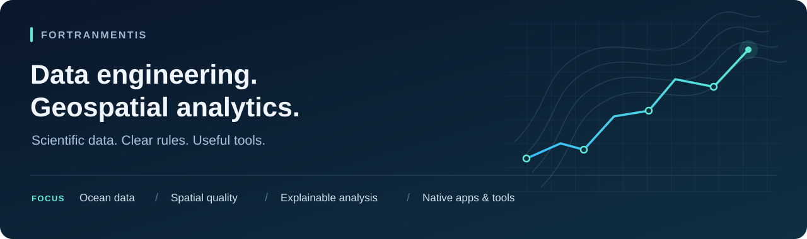

  

  <strong>From scientific datasets to interpretable analysis and practical tools.</strong>

  <a href="#user-content-english">English</a> ·
  <a href="#user-content-한국어">한국어</a> ·
  <a href="#user-content-selected-projects">Projects</a> ·
  <a href="#user-content-private-work">Private work</a> ·
  <a href="#user-content-in-action">Demos</a> ·
  <a href="#user-content-toolbox">Tech Stack</a> ·
  <a href="#user-content-github-stats">Stats</a>

---

## Hi, I'm fortranmentis 👋

I build data workflows, spatial applications, and developer tools, with a focus on **ocean and atmospheric datasets, geospatial processing, and explainable analysis**. My work spans scientific file processing, analytical reporting, indexed location search, and native mobile interfaces for data and server workflows.

I care about the details that make data useful: coordinate systems, temporal coverage, missing values, explicit acceptance rules, and a clear distinction between what a result shows and what still needs validation.

| Focus | What I build |
| :--- | :--- |
| **Data engineering** | Specification checks, NetCDF/CSV processing, raster conversion, and database/service integration |
| **Geospatial analytics** | Numerical-model grid matching, vessel trajectories, spatial joins, and map-based visualization |
| **Spatial applications** | Indexed local datasets, location/heading-aware search, opening-hours logic, and native iOS/Android experiences |
| **Developer tooling** | SSH/SFTP workflows, GPU/server telemetry, and LLM runtime monitoring |

## 🧰 Tech Stack

Technologies used across my public and private projects · 공개·비공개 프로젝트에서 사용하는 기술

**Data & Scientific Computing** · 과학 데이터 처리

  
  
  
  
  

**Geospatial & Visualization** · 공간정보·시각화

  
  
  
  
  
  

**Database** · 데이터베이스

  
  
  

**Native & Systems** · 네이티브·시스템

  
  
  
  

**UI & Applications** · UI·애플리케이션

  
  
  
  

Also used · 함께 사용하는 기술: pyproj · Bash · Docker · MapKit · Google Maps · ML Kit · UniFFI · JNI

---

## Selected projects

### 🌊 [Ocean Forecast GeoPipeline](https://github.com/fortranmentis/ocean-forecast-geopipeline)

**Connect recurring ocean and sea-ice products to geospatial services.**

Validates incoming NetCDF/CSV files against supplied specifications, regrids and reprojects raster products, derives current speed/direction from U/V components, updates PostgreSQL, and publishes selected GeoServer layers. Field-level reports retain the basis for acceptance decisions.

  
  
  
  
  

### 📍 [Multi-Model Grid Validator](https://github.com/fortranmentis/multi-model-grid-validator)

**Match service locations to nearby model cells that meet explicit value rules.**

Handles **15 model configurations** across ocean, wave, and atmospheric datasets. Selects the nearest eligible cell within **40 km**; non-WRF entries screen the first **up to 20 timesteps**, while WRF entries use coordinate-based matching. Parallel processing combines results into a location-level CSV.

  
  
  
  

### 🚢 [Busan AIS Ship Behavior Analysis](https://github.com/fortranmentis/Busan-AIS-ship-behavior-analysis)

**Make vessel movement patterns inspectable through rules and spatial context.**

Combines AIS trajectories, vessel metadata, and fairway/anchorage polygons to visualize stationary states, fairway exits, and candidate activities. Spatial preprocessing and parallel rendering produce satellite-map time-lapse videos. **Activity labels are heuristic candidates** that require independent confirmation.

  
  
  
  
  

### 🖥️ [GPUTERM](https://github.com/fortranmentis/GPUTERM)

**Bring remote server work into one desktop workspace.**

Combines an SSH terminal, SFTP transfers, and live system/GPU telemetry. Includes monitoring adapters for Ollama, vLLM, and other LLM runtimes, supporting the infrastructure side of data and compute workflows.

  
  
  
  

[Download GPUTERM](https://github.com/fortranmentis/GPUTERM/releases) · [Browse all repositories](https://github.com/fortranmentis?tab=repositories)

## Selected private work

Alongside the public projects, I develop the following tools in private repositories. These summaries describe their scope; source code and datasets remain private.

### 📱 GPUTERM for iOS & Android

**Extend remote compute workflows to native mobile workspaces.**

Native SSH/SFTP clients with system/GPU telemetry and LLM runtime monitoring. The iOS app connects **SwiftUI to Rust through UniFFI**; the Android app connects **Kotlin/Jetpack Compose to Rust through JNI**. The work includes terminal interaction, file transfers, adaptive layouts, and platform-specific credential handling.

  
  
  
  

### 🗺️ HelpPoopy / Korea Toilet Map

**Turn location datasets into useful decisions on a phone.**

Native iOS and Android restroom-finding apps with pedestrian discovery, direction-aware driving recommendations, operating-hours filters, and navigation handoff. A build-time Python workflow prepares **SQLCipher-backed SQLite data with R-Tree spatial indexes**, enabling viewport queries and local filtering. The apps also provide localized interfaces and on-device text translation.

  
  
  
  
  

[Public support & privacy site →](https://fortranmentis.github.io/Korea-Toilet-Map/)

### 📊 Environmental data reporting

**Automate recurring comparisons and summary reports.**

Python/pandas scripts consolidate spreadsheets, compare forecast-index outputs, aggregate regional differences, and summarize weather-event days and proportions. CSV, Excel, and styled HTML exports make the resulting tables easier to review. These are task-specific scripts rather than a packaged analytics platform.

  
  

## In action

<table>
  <tr>
    <th>AIS activity visualization</th>
    <th>GPU server workspace</th>
  </tr>
  <tr>
    <td width="50%"></td>
    <td width="50%"></td>
  </tr>
</table>

*Repository demo assets. The AIS animation illustrates the interface and heuristic overlays; it is not an accuracy benchmark.*

## How I approach data work

- **Define the contract.** Make input schemas, units, coordinate systems, and time semantics explicit.
- **Keep decisions inspectable.** Use traceable checks and readable rules so results can be reviewed.
- **Separate checks from conclusions.** Metadata conformity, value screening, and domain accuracy answer different questions.
- **Document the operating context.** Record configuration, dependencies, validation evidence, and recovery paths alongside code.

Also on this GitHub: [Korea Toilet Map](https://github.com/fortranmentis/Korea-Toilet-Map), the bilingual **support and privacy website** for the iOS app. [Visit the site →](https://fortranmentis.github.io/Korea-Toilet-Map/)

---

## 안녕하세요, fortranmentis입니다 👋

**해양·대기 데이터, 공간정보 처리, 설명 가능한 분석**을 중심으로 데이터 워크플로, 위치 기반 앱, 개발 도구를 만듭니다. 과학 데이터 처리와 분석 보고서부터 공간 인덱스를 활용한 위치 검색, 데이터·서버 작업을 위한 네이티브 모바일 UI까지 연결합니다.

좌표계, 시간 범위, 결측값, 명시적인 통과 조건처럼 데이터 활용의 신뢰도를 좌우하는 세부사항을 중요하게 생각합니다. 결과가 보여주는 내용과 추가 검증이 필요한 범위를 구분해 설명하는 것을 지향합니다.

| 관심 분야 | 구현하는 것 |
| :--- | :--- |
| **데이터 엔지니어링** | 규격 검증, NetCDF·CSV 처리, 래스터 변환, 데이터베이스·공간 서비스 연계 |
| **공간 데이터 분석** | 수치모델 격자 매칭, 선박 궤적 분석, 공간 조인, 지도 기반 시각화 |
| **위치 기반 앱** | 공간 인덱스가 있는 로컬 데이터, 위치·방향 기반 검색, 운영시간 판정, iOS·Android 네이티브 UI |
| **개발·운영 도구** | SSH·SFTP 작업 환경, GPU·서버 텔레메트리, LLM 런타임 모니터링 |

### 주요 프로젝트

| 프로젝트 | 해결하는 문제와 구현 내용 |
| :--- | :--- |
| 🌊 **[Ocean Forecast GeoPipeline](https://github.com/fortranmentis/ocean-forecast-geopipeline)** | 반복적으로 제공되는 해양·해빙 산출물을 공간 서비스로 연결합니다. NetCDF·CSV 규격 비교, 재격자화·재투영, U/V 기반 유속·방향 산출, PostgreSQL 갱신, 지정된 GeoServer 레이어 발행을 수행하며 항목별 판정 근거를 보고서에 남깁니다. |
| 📍 **[Multi-Model Grid Validator](https://github.com/fortranmentis/multi-model-grid-validator)** | 지점별로 값 점검 조건을 충족하는 최근접 모델 격자를 찾습니다. 해양·파랑·대기 **15개 설정**, **반경 40 km**를 지원합니다. 비 WRF 모델은 최초 **최대 20개 시점**의 값을 점검하고, WRF는 좌표로 매칭합니다. 모델별 병렬 처리 결과를 CSV로 통합합니다. |
| 🚢 **[Busan AIS Ship Behavior Analysis](https://github.com/fortranmentis/Busan-AIS-ship-behavior-analysis)** | AIS 궤적·선박 메타데이터·항로 및 정박지 폴리곤을 결합해 정지 상태, 항로 이탈, 활동 후보를 지도 타임랩스로 보여줍니다. 공간 전처리와 병렬 렌더링을 활용하며, **활동 표시는 독립적인 확인이 필요한 규칙 기반 후보**입니다. |
| 🖥️ **[GPUTERM](https://github.com/fortranmentis/GPUTERM)** | SSH 터미널, SFTP 전송, 시스템·GPU 텔레메트리를 하나의 데스크톱 작업 공간으로 통합합니다. Ollama·vLLM 등 LLM 런타임 모니터링을 제공해 데이터·연산 작업의 서버 운영을 지원합니다. |

[AIS·GPUTERM 화면 보기 ↑](#user-content-in-action) · [GPUTERM 다운로드](https://github.com/fortranmentis/GPUTERM/releases) · [전체 저장소](https://github.com/fortranmentis?tab=repositories)

위 AIS 데모는 화면과 규칙 기반 표시의 예시이며, 분류 정확도 검증 결과를 의미하지 않습니다.

### 비공개 프로젝트 경험

공개 프로젝트와 함께 아래 도구도 비공개 저장소에서 개발합니다. 구현 범위를 요약해 소개하며 소스 코드와 데이터셋은 비공개로 유지합니다.

| 프로젝트 | 구현 범위와 기술 |
| :--- | :--- |
| 📱 **GPUTERM iOS·Android** | SSH·SFTP, 시스템·GPU 텔레메트리, LLM 런타임 모니터링을 네이티브 모바일 환경으로 확장합니다. iOS는 **SwiftUI–UniFFI–Rust**, Android는 **Kotlin/Compose–JNI–Rust** 구조를 사용합니다. 터미널 입력, 파일 전송, 적응형 레이아웃, 플랫폼별 자격증명 처리를 다룹니다. |
| 🗺️ **HelpPoopy / 한국 화장실 지도** | 보행자 검색, 진행 방향을 고려한 운전자 추천, 운영시간 필터, 내비게이션 연결을 제공하는 iOS·Android 앱입니다. Python으로 준비한 **SQLCipher 기반 SQLite·R-Tree 공간 인덱스**를 활용해 지도 화면 범위 조회와 로컬 필터링을 수행합니다. 다국어 UI와 기기 내 텍스트 번역도 제공합니다. |
| 📊 **해양·기상 데이터 보고 자동화** | Python·pandas로 스프레드시트를 통합하고 예보지수 산출물의 차이, 지역별 집계, 기상 특이현상 발생 일수·비중을 정리합니다. CSV·Excel·스타일을 적용한 HTML 보고서를 출력하는 업무별 스크립트이며, 패키지 형태의 분석 플랫폼은 아닙니다. |

### 사용하는 기술

[공통 Tech Stack에서 분야별 기술 배지 보기 ↑](#user-content-toolbox)

과학 데이터 처리, 공간정보·시각화, 데이터베이스, 네이티브·시스템, UI·애플리케이션으로 나누어 소개했습니다.

### 데이터를 다루는 원칙

- **입력 조건을 명확히 합니다.** 스키마·단위·좌표계·시간의 의미를 먼저 정의합니다.
- **판정 근거를 남깁니다.** 추적 가능한 검증 항목과 읽을 수 있는 규칙으로 결과를 검토할 수 있게 합니다.
- **검사와 해석을 구분합니다.** 메타데이터 규격 일치, 값 조건 통과, 도메인 정확도는 서로 다른 질문입니다.
- **운영 맥락을 문서화합니다.** 설정·의존성·검증 근거·복구 절차를 코드와 함께 관리합니다.

추가 프로젝트: iOS 앱의 한·영 **지원 및 개인정보 처리방침 웹사이트**인 [Korea Toilet Map](https://github.com/fortranmentis/Korea-Toilet-Map)도 운영합니다. [사이트 방문 →](https://fortranmentis.github.io/Korea-Toilet-Map/)

---

## 📊 GitHub Stats

  
  

Public repository data only. Language percentages describe code composition, not proficiency. Cards may be cached. 공개 저장소 기준입니다. 언어 비율은 코드 구성비이며 숙련도를 뜻하지 않습니다. 통계에는 캐시가 적용될 수 있습니다.

---

  <strong>Clear inputs. Traceable decisions. Useful outputs.</strong> 
  명확한 입력 · 추적 가능한 판단 · 활용할 수 있는 결과

  <a href="#user-content-top">Back to top ↑</a> · <a href="#user-content-english">English</a> · <a href="#user-content-한국어">한국어</a>

